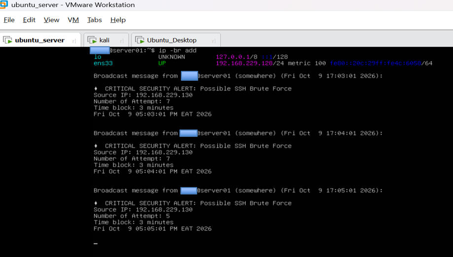
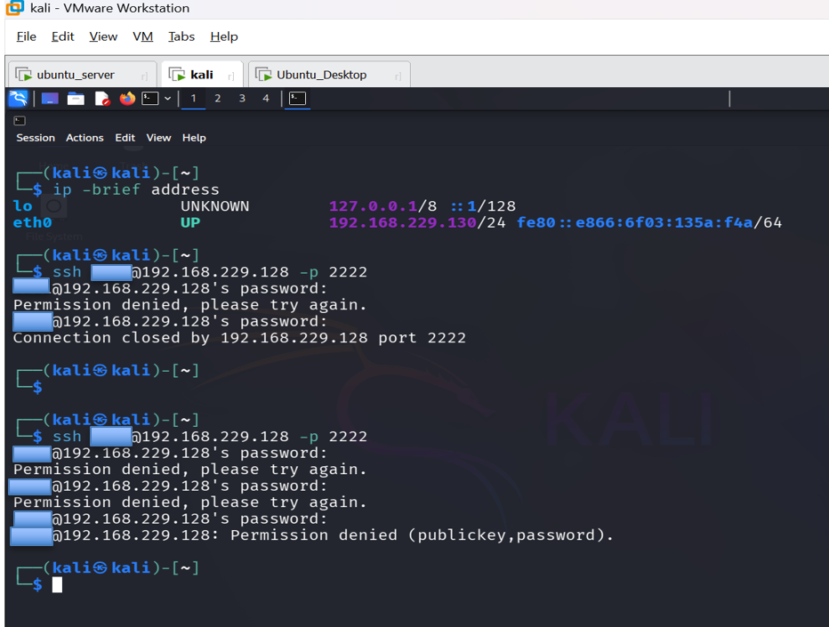
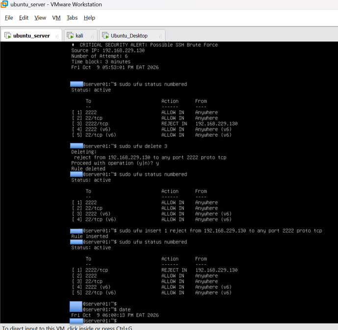
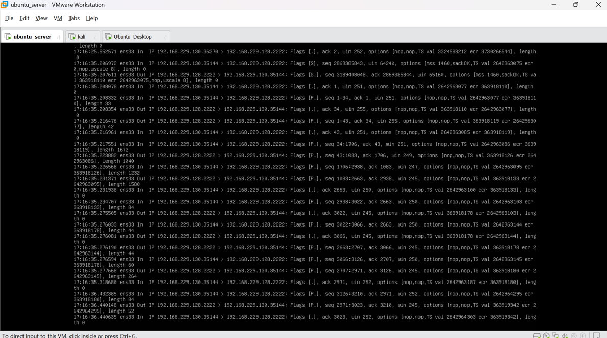

# SSH Brute-Force Detection, Alerting, and Firewall Response Lab

A hands-on cybersecurity lab focused on detecting repeated SSH authentication failures, generating security alerts with Bash, analyzing Linux authentication logs, and investigating firewall behavior in a virtualized lab environment.

## Overview

SSH is commonly used for secure remote administration of Linux systems. Repeated failed authentication attempts can indicate password-guessing activity and warrant investigation.

In this project, I built and tested a basic SSH brute-force detection workflow using Linux system logs, a Bash script, scheduled checks, terminal notifications, and persistent alert logging. I also investigated SSH connectivity and firewall behavior using UFW and `tcpdump`.

The lab demonstrates practical skills in security monitoring, log analysis, detection logic, Linux administration, network troubleshooting, and technical documentation.

## Objectives

- Identify repeated SSH failed-password attempts by source IP address.
- Develop a Bash script to analyze SSH authentication logs.
- Generate alerts when a defined detection threshold is reached.
- Schedule periodic detection checks using cron.
- Investigate SSH connectivity and firewall rule behavior.
- Capture and analyze network traffic to verify the source address observed by the target.
- Document findings, test evidence, limitations, and potential improvements.

## Lab Environment

The lab used three virtual machines:

| System | Role | Lab IP address |
|---|---|---|
| Kali Linux | Test client | `192.168.229.130` |
| Ubuntu Server | SSH target and detection system | `192.168.229.128` |
| Ubuntu Desktop | Additional test client | `192.168.229.131` |

**SSH service:** TCP port `2222`

These addresses belong to the private lab environment and are included to make the documented tests easier to follow.

## Tools and Technologies

- **Linux / Ubuntu:** Server administration and authentication-log analysis
- **Bash:** Detection script and alert handling
- **`journalctl`:** Retrieval of SSH service logs
- **`grep`, `awk`, `sort`, and `uniq`:** Filtering, extracting, and counting failed authentication events
- **cron:** Periodic execution of the detection script
- **UFW:** Firewall rule inspection and modification
- **`tcpdump`:** Network packet capture and source-IP verification
- **OpenSSH:** SSH service configuration and connectivity testing
- **Virtual machines:** Isolated lab environment for testing

## Detection Logic

The detection script follows this workflow:

1. Retrieves SSH service logs from the preceding three-minute window.
2. Filters entries containing `Failed password`.
3. Extracts source IP addresses from matching log entries.
4. Counts failed-password events for each source IP.
5. Identifies source IPs with at least five matching events.
6. Generates a security alert containing the source IP, attempt count, time-window description, and timestamp.
7. Broadcasts the alert to logged-in terminals and appends it to a persistent alert log.

**Detection script:** [View the Bash detection script](scripts/alert.sh)
The script is scheduled through cron to run once per minute.

**Detection threshold:** At least 5 failed-password events per source IP.

**Lookback window:** 3 minutes.

Because the script uses a rolling lookback window and runs periodically, the same events can appear in consecutive runs and generate repeated alerts. The threshold and duplicate-alert behavior require further validation.

### Testing and Observed Results

## Selected Evidence

### 1. SSH Brute-Force Detection Alert

The alert shows the source IP address and failed-password attempt count identified by the detection script.

### 2. SSH Authentication Logs

The log evidence shows the failed SSH password attempts examined during the lab.

### 3. Firewall and Packet-Capture Investigation

This evidence documents the firewall troubleshooting and packet-capture observations made during testing.

### 1. SSH authentication monitoring

Generated SSH authentication failures and inspected the target's logs to identify the relevant failed-password events.

### 2. Detection and alerting

Tested the detection workflow with multiple source IP addresses. The documented tests produced separate alerts for `192.168.229.130` and `192.168.229.131`, with six failed-password events recorded for each source in the respective test.

### 3. Alert logging

Verified that the detection workflow generated terminal notifications and wrote alert details to a persistent log file at `/var/log/alert.log`.

### 4. SSH service configuration

Configured OpenSSH to use TCP port `2222` and checked the listening sockets on the target system.

### 5. Packet capture and source-IP verification

Used `tcpdump` to inspect traffic associated with TCP port `2222`. The capture showed packets from `192.168.229.130` to `192.168.229.128`, supporting the conclusion that the expected source address was visible to the target during that test.

### 6. Firewall investigation

Inspected and modified UFW rules while investigating SSH connectivity. After inserting a source-specific reject rule ahead of a broader allow rule, a subsequent SSH connection attempt returned `Connection refused`.

This result documented the observed behavior during the test; it did not establish that rule ordering alone explained every earlier connectivity result.

## Evidence and Documentation

The project report documents the lab setup, detection script, test procedures, observations, troubleshooting, and limitations.

Evidence includes:

- SSH authentication-log inspection
- Detection script and alert output
- Multiple-source detection tests
- SSH port configuration and listening sockets
- UFW rule inspection and connectivity tests
- Packet capture and source-IP verification
- Persistent alert-log output

**Full report:** [Read the complete lab report](report/SSH_Brute_Force_Detection_Alerting_and_Firewall_Response_Report.pdf)

## Limitations

This is a learning and portfolio lab, not a production-ready detection and response system.

- Detection relies on periodic log polling rather than continuous event processing.
- Overlapping lookback windows can produce repeated alerts.
- Threshold-boundary behavior and duplicate-alert handling need further testing.
- Firewall changes were performed manually; automatic source-IP blocking was not implemented.
- IPv6 filtering behavior and additional attack scenarios were not fully validated.
- The lab does not demonstrate integration with a production SIEM, centralized monitoring platform, or automated incident-response workflow.

## Future Improvements

Potential improvements include:

- Test below-threshold, threshold, and above-threshold cases.
- Evaluate duplicate-alert suppression and persistent tracking of previously alerted events.
- Improve parsing robustness for different SSH log formats.
- Add automated, carefully controlled response actions in an isolated test environment.
- Validate IPv4 and IPv6 firewall behavior.
- Expand testing across additional authentication scenarios.
- Explore integration with a SIEM or centralized log-monitoring platform.

These are proposed improvements, not completed features of the current lab.

## Skills Demonstrated

- Linux system administration
- SSH authentication-log analysis
- Bash scripting and text processing
- Basic security detection engineering
- Cron-based task scheduling
- Security alert generation and logging
- Firewall troubleshooting with UFW
- Network traffic inspection with `tcpdump`
- Evidence-based investigation and technical reporting

## Disclaimer

This project was conducted in a controlled virtual lab for educational and professional portfolio purposes. Testing should only be performed on systems and networks for which authorization has been granted.

The findings describe the documented lab tests and should not be interpreted as proof of production-level detection accuracy or automated incident-response capability.

---

**Author:** Tadiwos Mesfin 
**Focus:** SOC Analysis | Security Monitoring | Incident Investigation

